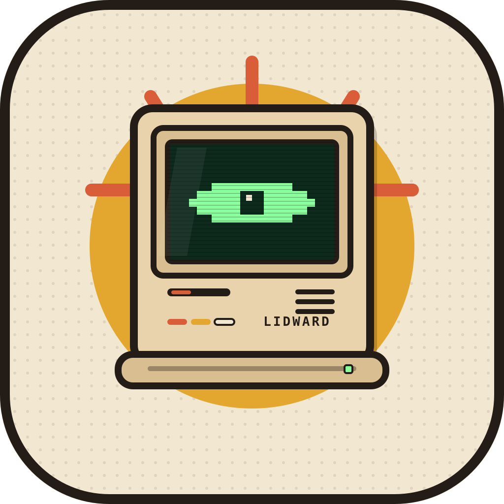
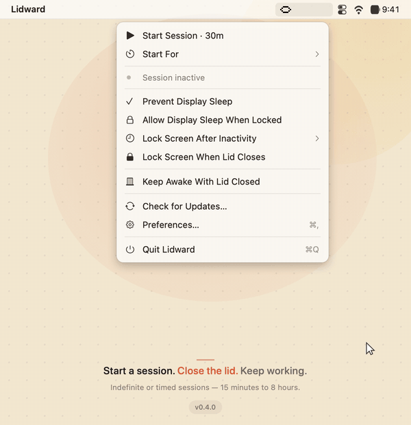

<p align="center">
  
</p>

<h1 align="center">Lidward</h1>

<p align="center">
  <strong>Your Mac stays awake. Even with the lid shut.</strong><br>
  A focused, native macOS menu-bar keep-awake utility.
</p>

<p align="center">
  
  
  
  
</p>

<p align="center">
  <a href="https://github.com/alouiadel/lidward/releases/latest"><strong>Download the latest release</strong></a>
  ·
  <a href="CHANGELOG.md">Changelog</a>
</p>

<p align="center">
  
</p>

---

**Lidward** is a small macOS menu-bar app that keeps your Mac awake for as long as you need. It is deliberately focused: only the controls that matter, no triggers, no schedules, no subscriptions, and no App Store sandbox.

The name is **lid + ward** — a small guard for your lid.

## Why Lidward?

Most keep-awake apps carry years of features you never touch. Lidward keeps the parts that matter and makes the one difficult part — closed-display mode — work without a separate download or manual setup.

## Features

### Session

- Menu-bar icon to start and stop a session
- **Indefinite or timed sessions** — choose 15 minutes, 30 minutes, 1 hour, 2 hours, 4 hours, or 8 hours
- Timed sessions stop automatically and show a live countdown
- Holds native macOS power assertions while active
- **Session time** in the menu bar — elapsed for indefinite sessions, remaining for timed sessions
- **Optional Dock icon** — hidden by default
- **Launch at login** (best when the app is in `/Applications`)
- **In-app purge uninstall** from Preferences
- **Preferences window** with session-length, menu-bar, Dock, startup, updates, and uninstall options

### Per-session controls

- Allow or prevent **display sleep**
- Allow display sleep **when the screen is locked**
- Allow or prevent **system sleep when the lid is closed** (Closed-Display Mode)
- **Lock the screen** after inactivity, or immediately after the display is closed
- Session controls live in the menu bar and persist between launches

### Closed-Display Mode, integrated

Closed-display mode usually needs a separate helper or a manually installed script. Lidward ships its own privileged helper:

- The first time you enable it, macOS asks for your administrator password **once**. Lidward installs a root-owned helper and a sudoers rule that allows only two commands: `pmset -a disablesleep 0` and `pmset -a disablesleep 1`.
- The helper is the executable that performs the toggle. The sudoers rule is the permission that lets that one helper run as root without a password each time. They are two pieces because the app itself must not run as root.
- After that, toggling closed-display mode does not ask for a password.
- The helper watches Lidward through a pipe. If Lidward quits or crashes, the pipe closes and the helper restores the previous sleep setting.
- Lidward also checks at launch and restores normal sleep if a previous run left the setting disabled without its helper state (for example after a reboot, logout, or forced quit). Quitting waits for the restore to finish.
- It re-applies the setting if macOS resets it after a power-source change.
- No script to download, no sudoers file to edit by hand, no kernel extension, no SIP changes.
- **Remove Closed-Display Helper…** appears in the menu only when the helper is installed, and removes both pieces.

> [!WARNING]
> Keeping a MacBook awake with the lid closed can cause heat and battery drain. Use it on a hard, ventilated surface — never in a bag. Lidward restores normal sleep when it can, but macOS can still force sleep at critical battery.

## Roadmap

- [x] Name, logo, license, README
- [x] App icon
- [x] Swift package + menu-bar shell
- [x] Indefinite and timed sessions with power assertions
- [x] Display sleep and lock-screen controls
- [x] Integrated closed-display helper
- [x] Session status/time in the menu bar
- [x] Hide in Dock preference
- [x] Preferences window
- [x] Launch at login
- [x] Install/uninstall build flags
- [x] Sanitized GitHub Releases
- [x] Changelog-driven release notes
- [x] Daily GitHub release check + manual check
- [x] In-app purge uninstall
- [ ] Full auto-update (Sparkle) if the app gets users

## Full-screen note

macOS hides the menu bar in a full-screen space. Move the pointer to the top edge to reveal it, then click Lidward. Lidward now opens its menu through a direct pop-up so it does not activate the accessory app and collapse the menu bar.

## Updates

Lidward checks the GitHub Releases API at most once a day for a newer version. When one is available, the menu shows **Download Lidward X…** and Preferences shows a download link.

- Automatic check: once a day; can be disabled in Preferences.
- Manual check: **Check for Updates…** in the menu, or **Check Now** in Preferences.
- Lidward does not self-install updates yet. Full auto-update (Sparkle) will be implemented if the app gets users.

## Build

Requirements: macOS 13+ and a Swift 5.9+ toolchain (Xcode or the Command Line Tools).

```bash
./scripts/build-app.sh                 # build and open dist/Lidward.app
./scripts/build-app.sh --install       # build and install to /Applications
./scripts/build-app.sh --uninstall     # remove /Applications/Lidward.app
./scripts/build-app.sh --purge         # remove app, preferences, login item, helper
./scripts/build-app.sh --package       # sanitized ZIP + SHA256 in dist/
./scripts/build-app.sh --release       # package and publish to GitHub Releases
```

Add `--no-open` when you do not want the app launched after building or installing.

The README demo is generated from the real Preferences UI with `./scripts/render-demo.sh` (requires `ffmpeg`).

The app icon is generated from `assets/logo.svg` with `scripts/make-icon.sh` and bundled as `AppIcon.icns`; the build script regenerates it if it is missing.

## Release packaging

Release builds are sanitized before they are zipped:

- built with `-gnone` so debug paths are not embedded
- stripped of debug and local symbols
- toolchain-only rpaths removed
- extended attributes and `.DS_Store` files cleared
- the build fails if the bundle contains `/Users/`, `/home/`, `adelaloui`, or `Adel Aloui`
- zipped with `ditto --norsrc --noextattr --noacl`
- the `.sha256` file contains only the asset filename, not the local path
- release notes are extracted from `CHANGELOG.md` for the current version

The app is ad-hoc signed, not notarized. On first launch, right-click → **Open**, or allow it in **System Settings → Privacy & Security**.

## License

[MIT](LICENSE) © 2026 Adel Aloui
